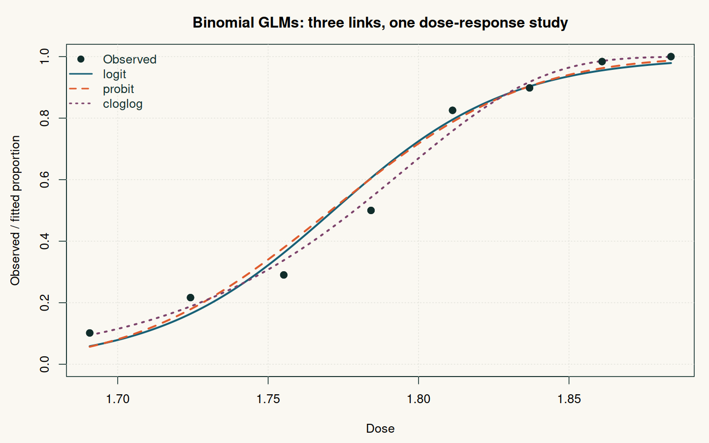

# GLM binomiaux : du score à l'ajustement

**Statistiques · R · Inférence · Modèles dose-réponse**

Comment le choix d'une fonction de lien modifie-t-il l'ajustement d'une réponse binaire ? Ce projet compare les liens **logit, probit et complémentaire log-log** sur huit groupes de scarabées exposés à différentes doses d'insecticide.

Travail universitaire réalisé par **Amadou Bocoum et Anya Levêque**, en M1 Data Science et Modélisation Statistique, Université Bretagne Sud (2025).



## Démarche

1. Écrire la vraisemblance binomiale, le score et l'information de Fisher.
2. Estimer les deux coefficients de chaque modèle par itérations de scoring de Fisher.
3. Comparer les proportions ajustées, la déviance et la statistique de Pearson.
4. Vérifier numériquement les estimations avec `stats::glm`, indépendamment du code de calcul manuel.

| Lien | Déviance résiduelle | Statistique de Pearson |
|---|---:|---:|
| Logit | 11,232 | 10,027 |
| Probit | 10,120 | 9,513 |
| Complémentaire log-log | 3,446 | 3,295 |

Les trois modèles ont deux paramètres. Le lien complémentaire log-log présente ici la plus petite déviance **sur les observations ayant servi à l'ajustement**. Ce n'est pas une comparaison prédictive sur un jeu de test.

## Reproduire et vérifier

R de base suffit, sans téléchargement de données ni paquet supplémentaire. Depuis la racine du dépôt :

```sh
Rscript scripts/reproduce.R
```

Le script exécute le travail original, vérifie les coefficients et les probabilités contre `glm`, puis produit la figure ci-dessus, les graphiques originaux et des tableaux CSV. Testé avec R 4.3.3. Les huit observations groupées sont présentes dans le script universitaire ; leur source bibliographique n'est pas précisée dans le sujet du projet .

## Lire le travail

- [Code universitaire original](analysis/coursework.R)
- [Rapport théorique](reports/theory.pdf)
- [Rapport pratique](reports/analysis.pdf)
- [Vérification et export des résultats](scripts/reproduce.R)
- [Résultats numériques](results/comparison.csv)


## Précision de publication

Les rapports et le script original sont un travail en binôme. Le script de vérification et cette présentation sont une couche de reproductibilité ajoutée pour la publication.
